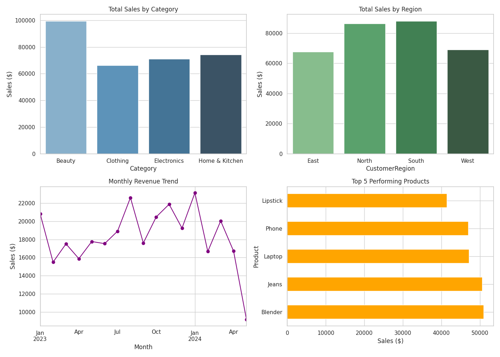

# 📊 Retail Sales Data Analysis & EDA Dashboard

An interactive Exploratory Data Analysis (EDA) dashboard built using Python, Pandas, Seaborn, Matplotlib, and Streamlit. This project analyzes retail sales performance across regions, product categories, and order volumes.

---

## 🖼️ Dashboard Preview


---

## 🌟 Key Features
* **Key Metrics**: Displays total revenue and key performance indicators dynamically.
* **Regional Insights**: Bar charts comparing revenue across North, South, East, and West regions.
* **Top Products**: Visualization of top 5 selling items.
* **Interactive Filtering**: Filter metrics and visuals by specific product categories in real-time.

---

## 🛠️ Tech Stack & Tools
* **Programming Language**: Python
* **Data Manipulation**: Pandas, NumPy
* **Data Visualization**: Matplotlib, Seaborn
* **Web App Framework**: Streamlit

---

## 📁 Repository Structure
```text
├── Sales_Data_Analysis.csv        # Raw dataset containing sales records
├── app.py                         # Streamlit dashboard application script
├── sales_dashboard_summary.png    # High-resolution dashboard chart image
└── README.md                      # Project documentation
